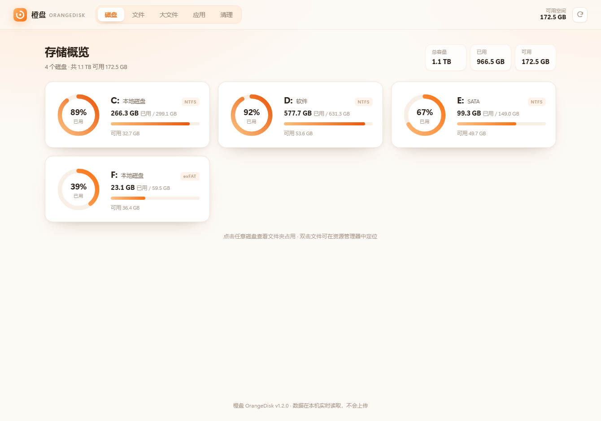
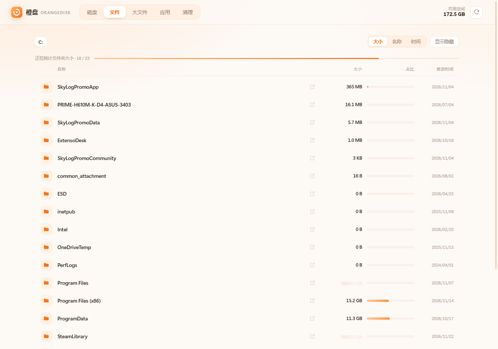
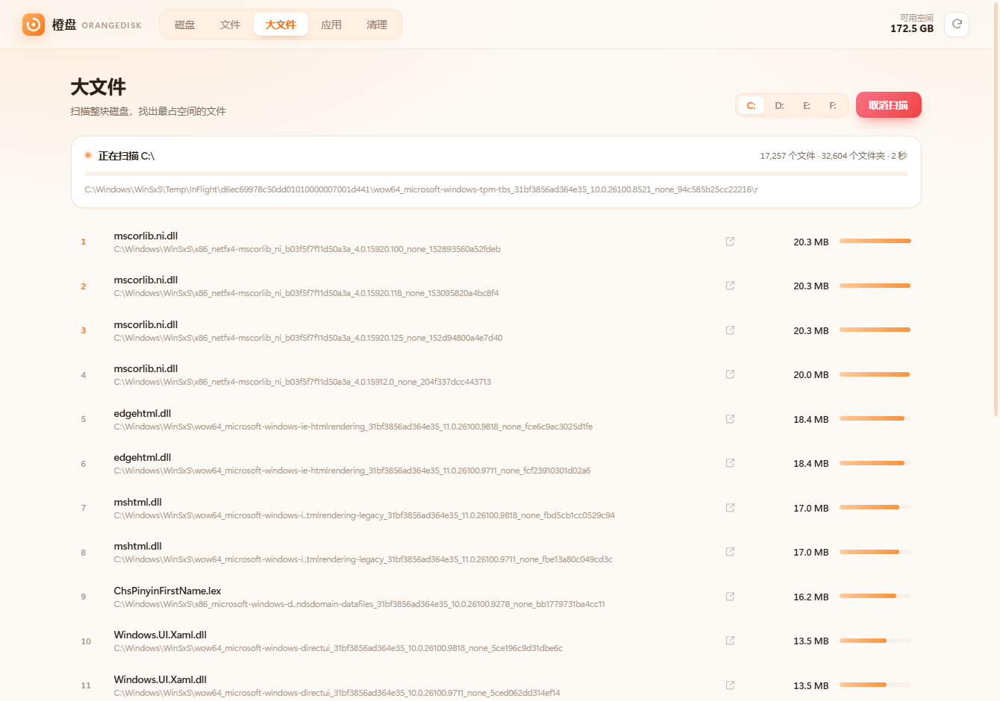

# 橙盘 · OrangeDisk

一个轻量的 Windows 磁盘占用查看器：看整体存储、逐层浏览文件夹体积、按应用大小排序、找出全盘大文件、按分类清理缓存。

浅色 + 橙色主题，零第三方依赖（只用 Node 内置模块 + 系统 PowerShell 读取卷标/应用列表），本机运行、数据不出本机。



## 安装 / 卸载

从 [Releases](../../releases) 下载最新安装包：

- **完整安装包** `OrangeDisk-Setup-1.2.0.exe`（33.5 MB，内含 Node 运行时，离线可装）
- **增量更新包** `OrangeDisk-Update-1.1.0-to-1.2.0.exe`（约 60 KB，只替换程序文件，适合已装 1.1.0 的机器）

双击安装，约 2 秒完成，自动创建桌面快捷方式、开始菜单项（含「卸载橙盘」），并登记到 Windows 的「应用」列表。

- 安装位置：`%LOCALAPPDATA%\Programs\OrangeDisk`，**不需要管理员权限**；
- 卸载：开始菜单「橙盘 → 卸载橙盘」，或「设置 → 应用 → 橙盘 OrangeDisk」；
- 静默参数：安装 `/quiet`，卸载 `OrangeDisk.exe --uninstall --quiet`（覆盖升级同样用 `/quiet`）。

关闭窗口后约 1 分钟内后台服务会自动退出，不会残留进程。

## 五个页签

**磁盘**：每个磁盘一个环形进度，显示卷标、文件系统、已用/可用与使用率。点击任意磁盘进入它的文件夹浏览。

**文件**：面包屑逐层浏览；每一行的「大小」会自动统计（大目录需要几秒，数字是边算边出现的）；右侧「占比」条是相对当前文件夹；支持按大小 / 名称 / 时间排序，可切换显示系统隐藏项；`Alt + ←` 返回上级。每行大小前的 <kbd>↗</kbd> 按钮可直接在资源管理器中打开该文件夹 / 定位该文件。



**大文件**：选一块盘点「开始扫描」，边扫边实时显示进度和当前目录，找出全盘最大的 20 个文件；可随时取消，同样有「打开位置」按钮。本机 C 盘 65 万个文件约 35 秒扫完。



**应用**：读取注册表里的已安装应用，按占用大小排序，可搜索应用名或发布者，点击一行打开其安装目录。

**清理**：按分类扫描缓存，勾选后清理。每类都是固定白名单路径，只删这些目录里的缓存文件，不碰用户文档、桌面、下载。


| 分类 | 风险 | 说明 |
|---|---|---|
| 用户临时文件 `%LOCALAPPDATA%\Temp` | 安全 | 自动跳过 20 分钟内新创建的文件 |
| 系统临时文件 `C:\Windows\Temp` | 安全（可能需管理员） | 被占用的文件自动跳过 |
| 崩溃转储 `CrashDumps` / `Minidump` | 安全 | 程序崩溃产生的诊断文件 |
| 着色器缓存 `D3DSCache` / NVIDIA / AMD / Intel | 安全 | 删除后游戏首次加载会重新编译 |
| 应用缓存 INetCache / 缩略图 / 图标缓存 | 安全 | 系统会自动重建 |
| 浏览器缓存 Edge / Chrome | 注意 | 不影响书签、密码、登录状态 |
| Windows 预读文件 `Prefetch` | 注意 | 删除后前几次启动略慢 |
| 回收站 | 危险 | 清空后无法恢复，默认不勾选 |

清理前会弹出确认框，列出每个分类的文件数和体积；正在使用或刚创建的文件会被跳过，并在结果里如实报告「删除了多少、跳过了多少」。


## 关于「≥」和统计速度

文件夹大小是逐个文件累加得出的，速度受磁盘与杀毒软件实时扫描影响（本机约 4 万文件/秒）。
超过 30 秒仍未扫完的目录会返回已统计的部分，并显示为 `≥ 57.6 GB`；这类结果只缓存 90 秒，稍后重新进入会再试一次。

## 文件结构

```
orange-disk/
├─ server.mjs        本地服务：磁盘 / 目录 / 大小 / 应用 / 大文件扫描 / 清理
├─ public/           页面（原生 HTML/CSS/JS）
├─ src/OrangeDisk.cs 启动器 + 安装器 + 更新器源码（同一份，三种编译）
├─ build.ps1         一键打包脚本
├─ dist/             本地打包产物（不入库）
├─ releases/         归档的历史安装包（不入库，发布在 Releases）
├─ 启动橙盘.vbs      开发用的免安装启动器
├─ icon.ico          应用图标
└─ make-icon.ps1     重新生成图标的脚本
```

## 从源码重新打包

```powershell
powershell -ExecutionPolicy Bypass -File build.ps1
```

只需要 Windows 自带的 .NET Framework 编译器（`csc.exe`），无需先装任何包。脚本会依次生成：

- `dist\OrangeDisk.exe` —— 启动器
- `dist\OrangeDisk-Setup-<版本>.exe` —— 完整安装包（含 node.exe）
- `dist\OrangeDisk-Update-<旧版本>-to-<版本>.exe` —— 增量更新包（只含程序文件）

## 版本历史

| 版本 | 内容 |
|---|---|
| v1.2.0 | 新增「清理」页签（8 类缓存分类、确认弹窗、安全跳过）；文件与大文件列表新增「打开位置」按钮；新增增量更新包 |
| v1.1.0 | 新增「大文件」页签；打包为 EXE 安装包；修复 `/select` 对含空格路径失效的问题 |

## 技术说明

- 纯 Node 内置模块，无 `npm install`，不需要联网。
- 服务只监听 `127.0.0.1`，端口从 7788 开始自动寻找空闲端口；已在运行时再次双击快捷方式只会新开一个窗口，不会起第二个服务。
- 浏览时不跟随符号链接 / junction，避免循环计数。
- 清理只遍历白名单目录，拒绝盘符根目录等高风险路径；不跟随符号链接；删除前跳过最近 20 分钟内修改的临时文件。
- 目录大小结果缓存 5 分钟；点击右上角刷新按钮可清空缓存重新统计。

## 常见问题

**装完打不开？** 安装包已自带 Node，正常不需要额外环境；若提示文件不完整，重新运行一次安装包即可。

**更新包提示「还没有安装橙盘」？** 增量更新包只能覆盖已安装的版本，请先用完整安装包安装。

**想换端口？** 改 `server.mjs` 顶部的 `BASE_PORT`，然后重新打包。
